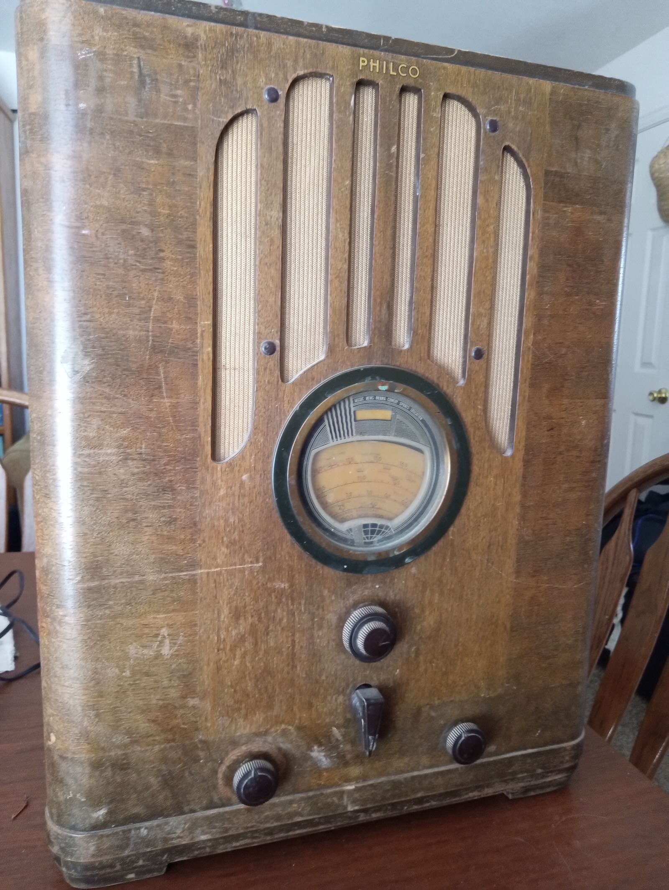
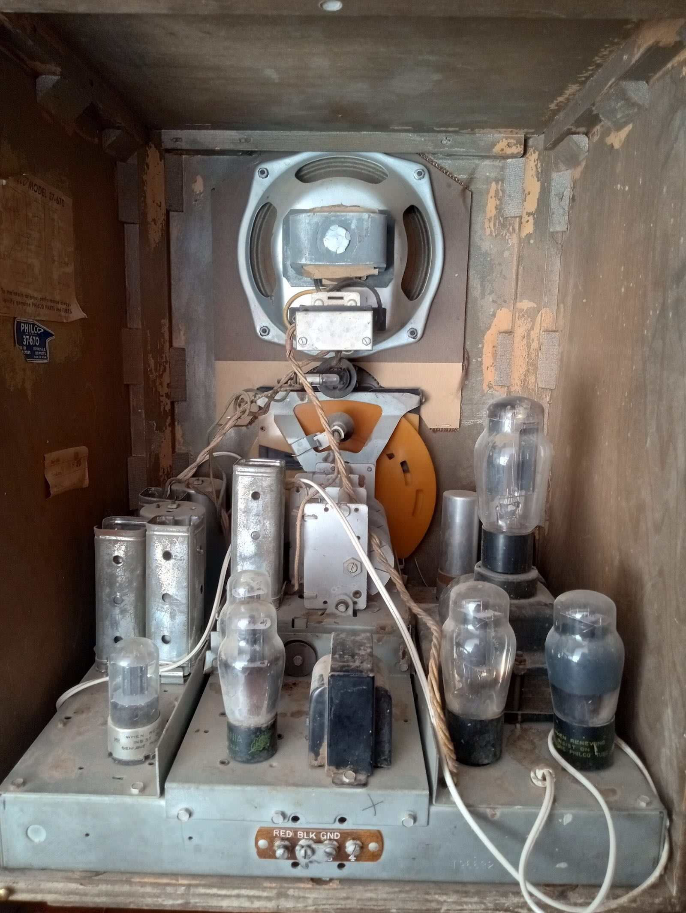

The Philco 37-670 is a radio that was offered both as a tabletop "tombstone"
model and a floor-standing console. I purchased the tombstone model which is
the 37-670B. I paid $100 for it, which incidentally was the MSRP when offered
in 1937. In today's dollars, that would be about $2300. This is my first
attempt at restoring an antique radio and should be a fun ride with lots of
bumps and turns.

### The Cabinet 

The cabinet is a walnut veneer, so I am told, and seems to be in decent shape.
This picture is taken immediately after I got it home, complete with all the
old dirt, smears, finger grease and character. The glass dial cover is intact
as are the 4 knobs, made of an early form of plastic called Bakelite. The 4
knobs operate the on/off switch, the 5 band selector (AM and 4 shortwave
bands), volume, and tuner. The grill cloth seems to be in great shape.

### The Chassis 
