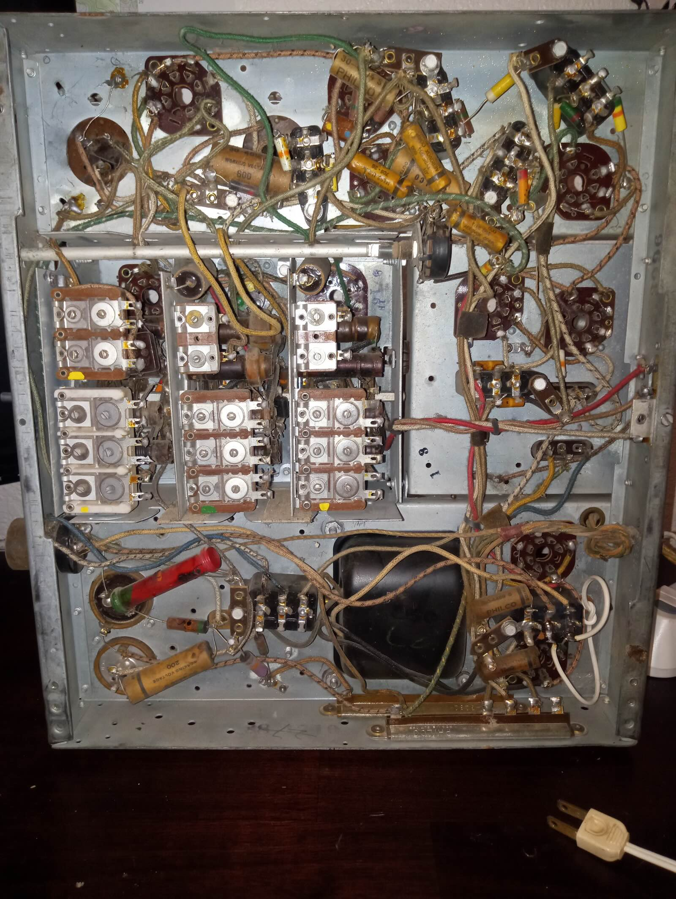

The Philco 37-670 is a radio that was offered both as a tabletop "tombstone"
model and a floor-standing console. I purchased the tombstone model which is
the 37-670B. I paid $100 for it, which incidentally was the MSRP
in 1937. In today's dollars, that would be about $2300. This is my first
attempt at restoring an antique radio and should be a fun ride with lots of
bumps and turns.

### The Front of the Cabinet 

The cabinet is a walnut veneer and seems to be in decent shape.
The image here was taken immediately after I got it home, complete with all the
old dirt, smears, finger grease and character. The glass dial cover is
thankfully still intact. There are 3 knobs and a triangular selector, all made
of an early form of plastic called Bakelite. The top knob is the tuner, made up
of a large outer wheel for making large adjustments and the small inner wheel
for finetuning. The two lower knobs operate the on/off switch and the volume
control. The selector is to choose one of the 5 possible bands: standard
broadcast (what we would call the AM band between 530 and 1700 kHz) and 4
shortwave bands (also technically
[AM](https://en.wikipedia.org/wiki/Amplitude_modulation)). The grill cloth
seems to be in great shape; I'm not sure but it may have been replaced at some
point. Overall, I'm quite happy with the cabinet and look forward to seeing
what it looks like after cleaning and waxing.

### The Back of the Cabinet: Chassis and Speaker 

According to the [Philco service
manual](/assets/docs/philco-service-manual.pdf), the 37-670 is "an 11 tube
[superheterodyne
receiver](https://en.wikipedia.org/wiki/Superheterodyne_receiver) designed for operation on alternating current." Most of the tubes are
visible here, though some have square metal shields. I first
wanted to remove the chassis and speaker so I could clean
the dust and debris from the cabinet. Though there are 4 holes with "rubber"
bushings to secure the chassis to the cabinet, only one had a screw.
I use the word rubber lightly since rubber seems to stop being rubber after
many years, losing all moisture and pliability and resembling compressed dry
desert clay that crumbles if you look at it wrong. The top of the chassis has a
considerable amount of rust in some spots though it was unclear at first how
deeply it penetrated.

Once I removed the chassis, I could more easily access the speaker. The paper
cone on the speaker looks quite delicate so I set it safely aside
since I won't be needing it for a while. This is a field coil speaker, using an
electromagnet instead of a permanent magnet for generating the magnetic field,
and I was eager to test the field coil to see if it was close to the specified
resistance from the schematic. It measured ~1140 &Omega; and the spec shows
1200 &Omega; so that is great news. 

### Chassis Underside

The underside of the chassis looks rust free (phew!) and the wiring is in relatively
good shape with no obvious breaks or signs of mouse activity, a concern when
looking at the rust spots on the top. There are many paper capacitors that will
need to be replaced, most of which are easy to get to. 

There is more Bakelite under here: the brown, insect looking blocks with 6
connections or legs on top, eye-shaped connectors that the tubes attach to and
multiple small connectors with rivets. The large red cylinder in the bottom
left of the image is actually a resistor, called a dog-bone resistor, that has
two metal caps and a carbon cylinder between them providing the necessary
resistance. What a beast!

The chassis is helpfully divided into sections that provide different
functions. The power section is the bottom third of the image, with the large,
black power transformer in the middle. The back of the on/off switch can be
seen on the left leading directly into this section. The intermediate frequency
(IF) section is the top third. The middle third is divided into two sections:
the one on the right is the audio section, with the long rod of the volume knob
leading to it, and the one on the left, itself divided into 3 sections,
contains the radio frequency (RF), oscillator, and antenna sections. 

### Next Time

In the next article, I will continue breaking down the chassis into its
component parts. Stay tuned!
